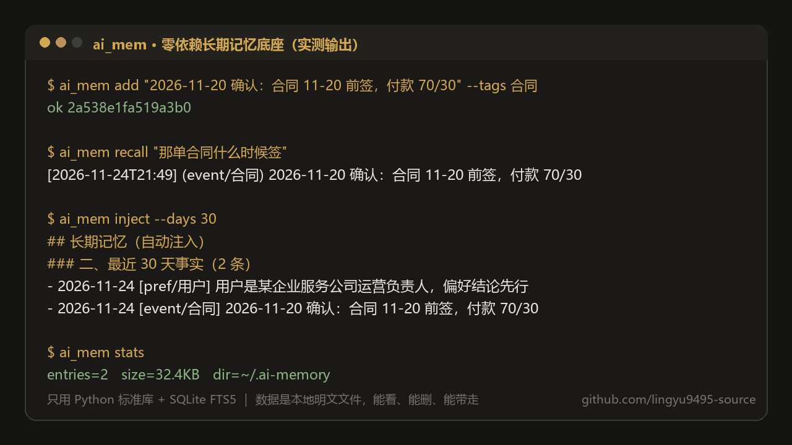

# Agent Memory Kit · 给你的 AI 装一个真正的长期记忆

[](LICENSE)
[](#)
[](#)


> 框架都**存得住，想不起**。这个包补的只有两件事：**自动记** 和 **主动想**。
> 零依赖、纯 Python 标准库、单机可用、数据明文可读可带走。



---

## 30 秒：先分清三样东西

| 东西 | 是什么 | 能当记忆底座吗 |
|---|---|---|
| 知识库 / Obsidian / 双链图谱 | 人写给**人**看的笔记 | ❌ 没有自动抽取和按需召回，AI 得自己翻文件 |
| RAG 检索库 | 文档切块、向量化、按问题捞片段 | 🔶 半个。能查到资料，但不会记住"你说过什么" |
| **记忆底座** | 专门管"谁、什么时候、说过/决定过什么"，自动写入、自动召回、可遗忘 | ✅ |

**一句话判据**：只能靠 AI 主动去搜的，是**书库**；能自动记、需要时自动想起的，才叫**记忆**。

---

## 5 分钟上手（A 档：零依赖）

```bash
git clone https://github.com/lingyu9495-source/agent-skills.git && cd agent-skills/agent-memory-kit
bash scripts/install.sh            # 装到 ~/ai-memory，建软链 ai_mem
```

手动等价三步：

```bash
mkdir -p ~/ai-memory/bin && cp scripts/ai_mem.py ~/ai-memory/bin/ && chmod +x ~/ai-memory/bin/ai_mem.py
export AI_MEM_DIR=~/ai-memory

ai_mem add "用户是 XX 公司运营负责人，偏好结论先行、不要客套" --tags 用户 --kind pref
ai_mem add "2026-11-20 确认：合同 11-20 前签，付款 70/30" --tags 合同 --kind event
ai_mem recall "那单合同什么时候签"      # 自动召回用 recall，不用 search
```

接进任何 Agent 的三处：

1. **系统提示**末尾追加 `ai_mem inject --days 7` 的输出（会话开始跑一次）
2. **AGENTS.md / CLAUDE.md** 加一条规矩：`开工先 inject，收尾把结论 add 进去`
3. **定时任务**：每天或每周 `ai_mem digest`，把细节沉到月度归档

> 完整框架接法（Hermes / QwenPaw / DSH / OpenClaw / Claude Code）见 `docs/03-部署SOP.md`。

---

## 它做什么 / 不做什么

**做**：事实与决定入库、按关键词和时间召回、热/温/冷三层、明文可备份、一成员一目录隔离。
**不做**：不是向量数据库、不做图谱推理、不替你自动判断"什么值得记"（写入规约要你定）。

**能力边界（对客户要讲清）**：
- 不承诺"永不忘记"，承诺"**做过的事它会先翻档案再动手**"
- 不承诺跨客户迁移；客户数据不出客户机器
- 中文整句查询必须走 `recall`（见坑清单），`search` 只适合人名/编号/条款号

---

## 三档选型（别一上来就上重的）

| 档 | 方案 | 依赖 | 常驻内存 | 适合 |
|---|---|---|---|---|
| **A 轻量**（默认） | 本包 `scripts/ai_mem.py`，sqlite FTS5 | 仅 Python3 | <30MB | 客户机、4G 内存、无人运维 |
| **B 标准** | OpenViking 单机 + 云端 embedding | Python3.12 + 常驻进程 | ~450MB | 8G+ 内存、要语义召回与多成员隔离 |
| **C 重型** | Hindsight / Mem0 / Graphiti | Docker / Postgres / Neo4j | 2.5GB+ | 要时序追溯与图谱推理，4C8G 以上 |

决策树：≤4G 或没人运维 → **A**；要"自动抽取"且 8G+ → **B**；事实会变、要回答"三月时是什么状态" → **C**（否则别碰）。

选型三条件，按顺序看：**机器算力 → 许可证 → 谁付 embedding 的 API 钱**。星标数不参与决策。

---

## 验收四步（缺一步不算装好）

1. **写入**：`ai_mem add "暗号：蓝鲸" --tags 测试`
2. **同会话召回**：`ai_mem recall 蓝鲸` 命中
3. **跨会话召回**：**重启进程/新开会话**，让它自己想起来 —— 90% 的"假成功"死在这一步
4. **隔离**：换另一个成员的目录/账号搜同一个词，必须搜不到

> 判成功的硬证据不是"它答得像"，而是**会话文件里能 grep 到你注入的原文标记**。模型不调工具也能编出"我记得"，但编不出你写的注入文本。

---

## 目录

```
agent-memory-kit/
├── README.md                     ← 你在这里
├── LICENSE                       MIT
├── docs/
│   ├── 01-为什么AI需要记忆底座.md   概念与判据
│   ├── 02-三层架构与选型.md         热/温/冷 + A/B/C 三档
│   ├── 03-部署SOP.md               六步交付，按框架分路
│   ├── 04-验收与踩坑.md            四步验收 + 18 个坑
│   └── 05-多端与共享架构.md         主库唯一 / 本地兜底 / 只读镜像
├── skills/
│   ├── memory-base-deployment/    可整包转发给别的 AI 执行
│   └── memory-hygiene/            记忆修剪与归档
├── scripts/
│   ├── ai_mem.py                  零依赖底座
│   ├── install.sh                 一键安装 + 自检
│   └── memory_hook.py             自动召回钩子示例
├── templates/MEMORY.template.md
└── examples/claude-code/CLAUDE.md.snippet
```

---

## License

MIT © 2026 九品锦里e

第三方方案（OpenViking / Hindsight / Mem0 等）各自遵循其原许可，本包不包含其代码。**AGPL-3.0 的方案对客分发前须过法务**，详见 `docs/04-验收与踩坑.md`。
